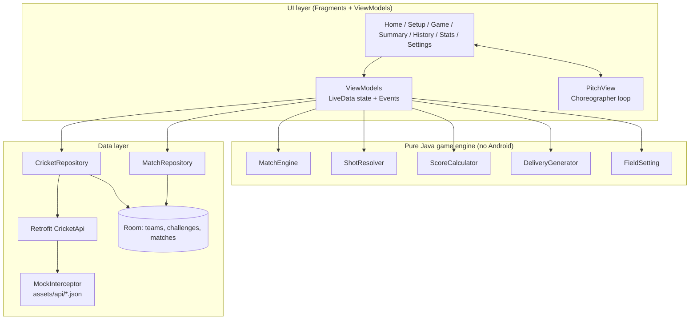
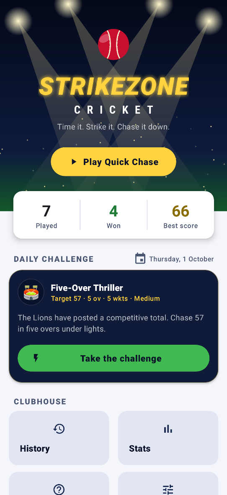
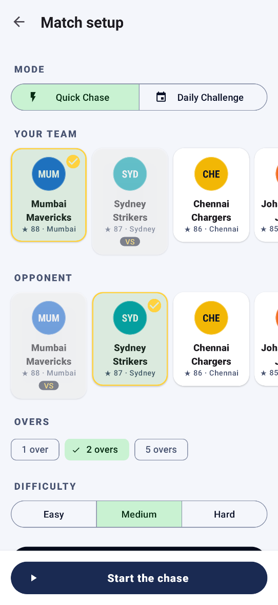
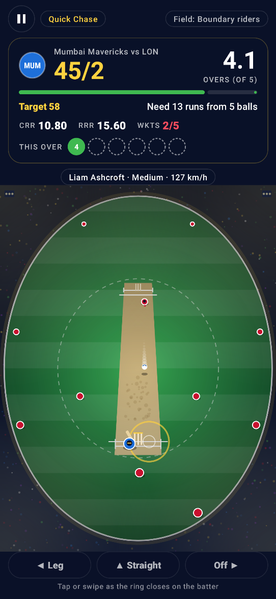
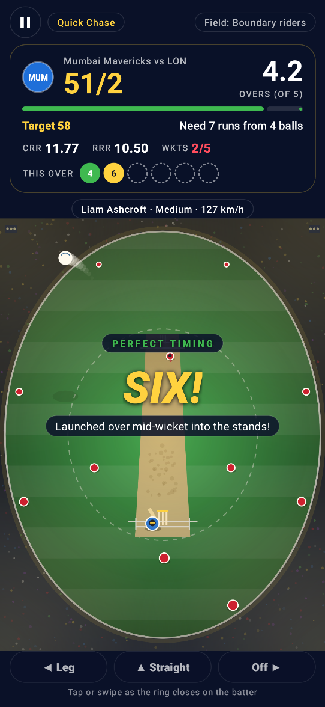
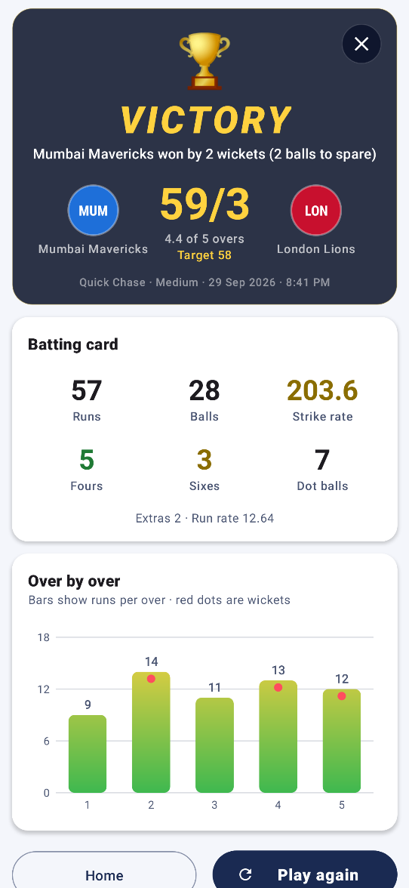
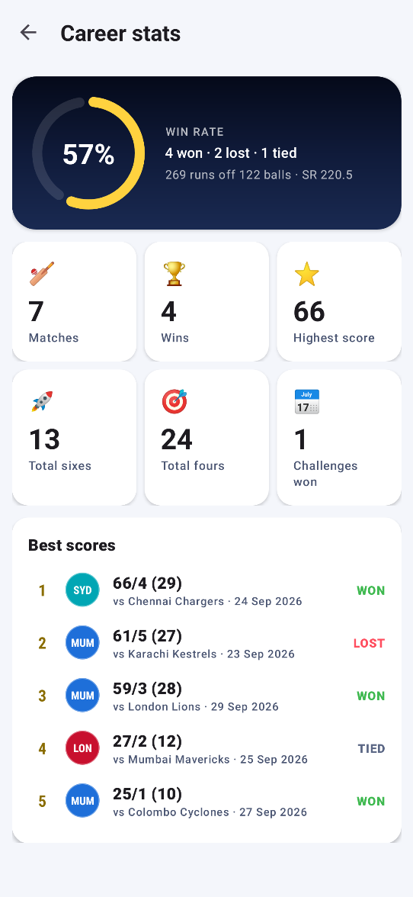
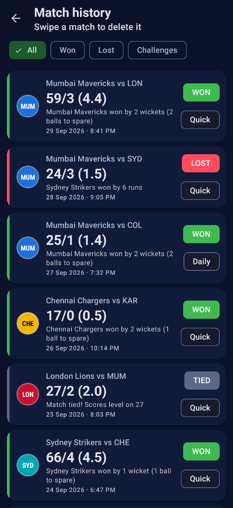

# StrikeZone Cricket

An arcade cricket batting game for Android. You chase a target under floodlights over a few overs, and you score by timing each shot and picking a direction.


The whole project is written in **Java**: the app, the custom game view and the unit tests. It uses XML Views, the Navigation Component, Hilt, Room, LiveData and Retrofit.

## Features

- **Hand-drawn game view.** `PitchView` draws a night-stadium ground on a Canvas: an oval outfield with mowing stripes, floodlight glow, the 30-yard circle, the pitch strip and creases, stumps, the fielders, the bowler's run-up and the batter. A `Choreographer` loop drives it at the display refresh rate. The static ground is rendered once into a bitmap, and the per-frame drawing doesn't allocate.
- **Timing-based batting.** An approach ring closes on the hitting zone and turns green inside the *perfect* window. A tap or swipe counts as early, perfect, late or a miss. You aim by tapping the left, centre or right of the pitch, or by swiping left, up or right.
- **Deliveries vary.** Pace, medium and spin bowlers each have their own speed band, run-up and post-bounce deviation. Every ball gets a random line (including wides) and length (yorker, full, good, short). The ball's shadow shows the bounce.
- **Outcomes come from the field.** A deterministic `ShotResolver` takes your timing, how well your shot matches the line, the length and the current field. It can return a dot, 1, 2, 3, 4, 6, caught, bowled, run out or wide. Each outcome has its own animation: the ball's trajectory after the hit, a glow on the catching fielder, stumps and bails flying, and a floodlight flash on a six.
- **The captain sets fields.** There are attacking, balanced and "boundary rider" plans, and the plan changes each over. The HUD shows the current plan and the fielders appear on the ground.
- **Live scoreboard HUD.** It shows runs and wickets, overs, the target, the chase equation, current and required run rates, a chase progress bar, colour-coded ball chips for this over and the bowler's name, type and speed.
- **Match setup.** Choose from 8 fictional franchises (Mumbai Mavericks, Chennai Chargers, London Lions, Sydney Strikers…), 1, 2 or 5 overs, Easy, Medium or Hard, and **Quick Chase** (random target, re-rollable) or **Daily Challenge**.
- **Daily Challenge.** A curated chase with a fixed opponent, target, difficulty and bowling plan (pace-only or spin-only attacks). It comes from the mock tournament API and a new one rotates in each day. Winning it marks it as completed.
- **Match summary.** You get a victory, defeat or tie headline, the result line ("won by 2 wickets (5 balls to spare)" / "won by 12 runs"), a batting card (runs, balls, 4s, 6s, strike rate, dots, extras) and an animated **Manhattan chart** with wicket markers, drawn in a custom View.
- **History and stats.** Every completed chase is stored in Room. History has filters (All, Won, Lost, Challenges) and swipe-to-delete with undo. The stats screen shows a win-rate ring, matches, wins, highest score, total sixes and fours, challenges won and your top-5 scores.
- **Settings.** Default difficulty and overs, vibration on or off, and System, Light or Dark theme. You can also reset your history.
- **Polish.** Splash screen, adaptive launcher icon, edge-to-edge insets, Material 3 light and dark themes, Material motion transitions, an animated home title over sweeping floodlight beams, a skeleton loader, empty states and haptic feedback for shots, boundaries and wickets.

## Rules in short matches

Ten wickets would make a 1–5 over chase trivial, so the wicket allowance scales with the overs (`MatchRules.wicketsForOvers`):

| Overs | Wickets |
|------:|--------:|
| 1     | 2       |
| 2     | 3       |
| 5     | 5       |

An over is **six legal balls**. A wide adds one run and has to be bowled again. You **win** the moment you reach the target. You **lose** if you run out of wickets or balls before that, and finishing one run short is a **tie**. On a run-out you are credited the single you completed before the direct hit.

## Tech stack

| Area | Library / approach |
|------|--------------------|
| Language | Java 17 (no Kotlin sources) |
| UI | XML Views, ViewBinding, Material Components 3, custom Canvas views |
| Navigation | Navigation Component (single activity, `nav_graph.xml`) |
| Architecture | MVVM + Repository, `ViewModel` + `LiveData`, one-shot `Event` wrapper |
| DI | Hilt (`@HiltAndroidApp`, `@AndroidEntryPoint`, `@HiltViewModel`, `@Provides`/`@Binds`) |
| Persistence | Room (Java DAOs returning `LiveData`, SQL aggregates for stats) |
| Settings | Typed `SharedPreferences` wrapper (`AppSettings`) |
| Networking | Retrofit + Gson, served offline by an OkHttp `MockInterceptor` from `assets/api/*.json` |
| Concurrency | Injected `AppExecutors` (`ExecutorService` for disk/network, main-thread executor) |
| Animation | `Choreographer` game loop, `ValueAnimator`, `ViewPropertyAnimator`, `MaterialSharedAxis` / `MaterialFadeThrough` |
| Testing | JUnit 4, Truth, `androidx.arch.core:core-testing`; Robolectric (native graphics) + Roborazzi + `hilt-android-testing` for screenshot tests |

## Architecture



- **Engine.** The `engine` package is plain Java with no Android imports. `MatchEngine` counts balls into overs, rotates bowlers and decides the result. `ShotResolver` turns a `Delivery` plus the player's `ShotInput` into a `BallOutcome` using weighted tables and an injected `Random`, so the same seed always gives the same result. `ScoreCalculator` handles run rates, overs notation, strike rate and the result text.
- **Game loop.** `PitchView` animates a `DeliveryCommand` and reports the swing's offset from the moment the ball arrives. `GameViewModel` resolves the shot, records it, publishes a new `GameUiState` and sends the outcome back for animation. When the match ends, the ViewModel saves a `MatchEntity` and the screen moves to the summary.
- **Data.** On first launch the repository fetches teams and daily challenges through Retrofit (300–700 ms simulated latency) and caches them in Room. Room is the single source of truth after that. Everything runs offline.

## Package structure

```
io.github.ieswar23.strikezone
├── StrikeZoneApp.java, MainActivity.java
├── engine/                 # Pure Java game logic (unit-tested)
│   ├── MatchEngine, MatchConfig, MatchRules, MatchStatus, Over, Ball, Bowler
│   ├── ShotResolver, TimingJudge, ShotInput, BallOutcome, OutcomeType, Timing
│   ├── Delivery, DeliveryGenerator, BowlerType, Difficulty, Line, Length
│   ├── FieldSetting, Fielder, ShotDirection, WeightedPicker
│   └── ScoreCalculator, TargetGenerator
├── data/
│   ├── local/              # AppDatabase, MatchStats, dao/, entity/
│   ├── remote/             # CricketApi, MockInterceptor, dto/
│   ├── repository/         # CricketRepository, MatchRepository (+ defaults), CatalogMapper
│   └── settings/           # AppSettings
├── domain/model/           # Team, DailyChallenge, MatchSetup, GameMode
├── di/                     # AppModule, DatabaseModule, NetworkModule, RepositoryModule, RandomModule
├── ui/
│   ├── home/  setup/  game/  summary/  history/  stats/  howto/  settings/
│   └── common/             # FloodlightView, ManhattanChartView, TeamBadge
└── util/                   # AppExecutors, Event, UiState, SyncState, LiveDataUtils, Haptics, …
```

## Getting started

1. Install **Android Studio Ladybug (2024.2.1) or newer** with **JDK 17**.
2. Clone the repository and open the project folder in Android Studio.
3. Let Gradle sync, then run the `app` configuration on a device or emulator (API 24+).

From the command line:

```bash
./gradlew assembleDebug
```

You don't need any API keys or network access. The tournament API is mocked from bundled JSON.

## Testing

```bash
./gradlew testDebugUnitTest
```

There are 34 JVM unit tests:

- `ShotResolverTest`: the same seed gives identical outcomes; perfect shots into an unguarded zone are never out; boundary riders take catches; wides; leaves; misses that hit the stumps; perfect timing beats early timing; shot power; timing windows; difficulty and speed bands.
- `MatchEngineTest`: six legal balls per over (wides excluded); the chase completes on reaching the target; all out; tie; out of balls; bowler rotation; per-over breakdown; the wicket allowance rule.
- `ScoreCalculatorTest`: run rates (including edge cases), overs notation, strike rate, won/lost/tied result text, the chase equation, win percentage and Quick Chase target bands.
- `GameViewModelTest`: a full simulated chase with fake repositories saves a consistent scorecard; leaving every ball loses; a missing team triggers the error state; a spin challenge uses only spinners.
- `MatchSetupResolveTest`: team defaults and clash resolution; Daily Challenge locks the opponent, overs and difficulty.

### Screenshot tests

`AppScreenshotTest` renders the real app on the JVM with Robolectric native graphics and records the
images below with [Roborazzi](https://github.com/takahirom/roborazzi). It launches the Hilt `MainActivity`,
waits for the mock API to fill Room, inserts a match history and navigates with the `NavController`. The
game shots replay a scripted chase through `GameViewModel` with a seeded `Random` (swapped in with
`@UninstallModules(RandomModule.class)`), then freeze `PitchView` mid-delivery.

```bash
./gradlew recordRoborazziDebug   # regenerates docs/screenshots/*.png
```

These tests are excluded from a plain `./gradlew testDebugUnitTest` (and CI), so the regular run stays fast.
`./gradlew testDebugUnitTest -PrecordScreenshots=true` records them too.

## Screenshots

<table>
  <tr>
    <td align="center"><br/><sub>Home: floodlit title, quick stats and today's challenge</sub></td>
    <td align="center"><br/><sub>Match setup: teams, overs and difficulty</sub></td>
    <td align="center"><br/><sub>The chase: ball in flight, live HUD and field</sub></td>
  </tr>
  <tr>
    <td align="center"><br/><sub>Perfect timing: SIX! over mid-wicket</sub></td>
    <td align="center"><br/><sub>Match summary with the Manhattan chart</sub></td>
    <td align="center"><br/><sub>Career stats and personal bests</sub></td>
  </tr>
  <tr>
    <td align="center"><br/><sub>Match history (dark theme)</sub></td>
  </tr>
</table>

## Roadmap

- Bat and crowd sound effects with `SoundPool`, plus a commentary ticker.
- Left-handed batter option that mirrors the off and leg sides.
- Multi-innings mode where you also bowl, with an AI batting side setting the target.
- Weekly leaderboard for Daily Challenges, backed by a real API.

## Author

**Eswar Reddy Madhira** — Android Developer

[](https://www.linkedin.com/in/eswar-reddy-android)
[](https://github.com/iEswar23)
